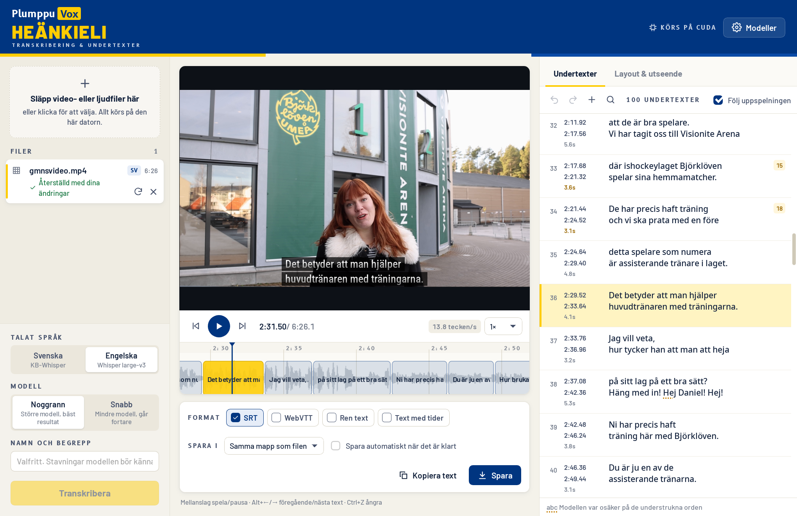

# PlumppuVox Heänkieli

Local transcription and subtitles for Swedish and English. Everything runs on the
computer: NVIDIA GPUs (CUDA) on Linux, Apple Silicon (Metal) on macOS.

- **Swedish** with KBLab's [KB-Whisper](https://huggingface.co/KBLab/kb-whisper-large), **English** with OpenAI Whisper large-v3.
- **Accurate or Fast**: a large model with beam search, or a smaller model that is quicker.

  | | Accurate | Fast |
  |---|---|---|
  | Swedish | KB-Whisper large (3.1 GB) | KB-Whisper medium q5 (0.54 GB) |
  | English | Whisper large-v3 (3.1 GB) | Whisper large-v3 turbo q8 (0.87 GB) |

  Models are downloaded from Hugging Face the first time they are needed.
  Downloads resume if interrupted, and each file is checked against its SHA-256.
  They are stored in `~/.local/share/com.plumppu.heankieli/models` on Linux and
  `~/Library/Application Support/com.plumppu.heankieli/models` on macOS. The
  **Models** dialog shows them and can delete them.
- **Preview** the subtitles on the video, in the style they will be watched.
  The default template follows SVT Play: a
  condensed grotesque (Roboto Condensed, the closest free match to SVT's
  letterforms; Archivo with an adjustable width is the alternative), in white shading to grey with a soft shadow, on a
  see-through dark plate per line, the lines left-aligned in a centred block; at
  most two lines of 37 characters, 1.5–6 s on screen and about 14 characters per
  second. Other templates: 42-character streaming style, one line for web clips,
  and vertical video. Characters per line, lines, durations, reading speed, gaps,
  line balance, text size, weight, background and position can all be adjusted,
  and the subtitles re-flow live.
- **Edit**: fix the text, split a subtitle at the cursor, merge with the next,
  delete, insert a new subtitle at the playhead, set start or end to the
  playhead, drag cue edges on the timeline, find and replace, and undo/redo. Edits
  are stored on the words themselves, so they survive a change of layout, and
  everything is autosaved per file.
- **Save** as SRT, WebVTT, plain text (paragraphs) or text with timestamps, next
  to the media file (`film.sv.srt`) or in a chosen folder. Use **Save all** for
  the whole queue, or save automatically when each file is done.
- **Queue**: drop several files and transcribe them in one go.
- Interface in Swedish or English, following the system language.

## How it works

1. ffmpeg decodes the first audio track to 16 kHz mono.
2. Silero VAD finds the speech. Only the speech is sent to Whisper (joined with
   short silences), which stops the model inventing text in long pauses and
   music. Every timestamp is mapped back to the original timeline.
3. whisper.cpp transcribes with DTW token timestamps, which gives each word its
   own time.
4. The subtitle layout (`src/lib/layout.ts`) splits the words into subtitles and
   lines with a cost-based search. It prefers sentence ends and clause
   boundaries, avoids breaking after function words such as *och*, *att*, *the*
   and *of*, avoids lone words, and keeps a sentence from starting mid-line. It
   then sets the timing from minimum duration, reading speed, gaps and frame
   snapping.

The player streams the file from a small HTTP server on 127.0.0.1, which only
serves files the app has opened. If the web view cannot decode the video (for
example H.264 on Linux without GStreamer's libav plugin), the app makes a VP8
preview copy with ffmpeg and plays that instead.

## Requirements

- **ffmpeg**: bundled with the macOS and Windows builds (ffmpeg 9.0.2, GPL, from
  [Martin Riedl](https://ffmpeg.martin-riedl.de) and [Gyan](https://www.gyan.dev/ffmpeg/builds/)).
  On Linux it comes from the system (`pacman -S ffmpeg`, `apt install ffmpeg`).
- Linux: WebKitGTK 4.1 and GStreamer (`gst-plugins-good`; `gst-libav` lets
  most files play without a preview copy), an NVIDIA GPU with the CUDA runtime.
- macOS 13+ on Apple Silicon.

## Build

Requirements: Rust, Node 20+, CMake, and on Linux the CUDA toolkit (`nvcc`).

    npm install

    # Linux, NVIDIA
    PATH=/opt/cuda/bin:$PATH npx tauri build --features cuda
    # Linux without CUDA: --features vulkan, or no feature for CPU only

    # macOS (Metal is always on)
    npx tauri build

For development, use `npx tauri dev --features cuda`. To build for the GPU in
this machine only, set `CMAKE_CUDA_ARCHITECTURES=native`.

Tests: `npm test` (layout and formats), `npm run check` (types).

The command-line example transcribes a file with the app's engine and prints
JSON:

    cargo run --release --features cuda --example hk -- sv-accurate film.mp4

## Command line

    heankieli [--ui sv|en] [--lang sv|en] [--fast|--accurate] [--start] [--at SECONDS] FILE...

Files given as arguments are added to the queue, so "Open with…" from a file
manager works. `--start` transcribes them straight away.

## License

AGPL-3.0-or-later, like the other Plumppu projects (see `LICENSE`).

## Fonts

Barlow, B612, Archivo, Roboto Condensed and Noto Sans, all under the SIL Open Font License (see
`src/assets/fonts`).
